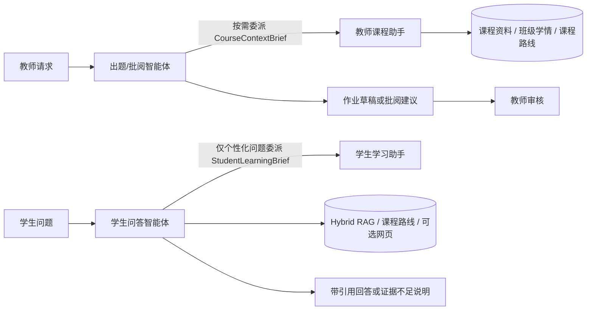

# AIedu Agentic Learning Platform

AIedu 是一个面向高校课程的、可审计的四智能体协作学习平台。项目不是把每个功能都包装成 Agent，而是在现有 FastAPI、Vue 2、MySQL、Redis、RocketMQ、Qdrant 和 MinIO 业务系统上，加入四个边界清晰的业务智能体。

## 四个智能体

| 智能体 | 负责 | 不负责 |
|---|---|---|
| 教师课程助手 | 课程资料、班级学情、课程知识路线 | 出题、评分、发布 |
| 教师出题/批阅智能体 | 作业草稿、Rubric、评分建议、Reflection | 自动发布、自动确认成绩 |
| 学生学习助手 | 画像解释、诊断/巩固练习、学习建议 | 修改掌握度或分数 |
| 学生问答智能体 | Agentic RAG、资料引用、作业防抄、网页信息 | 无证据编造、直接代写开放作业 |

只有两条跨智能体委派：出题智能体 → 教师课程助手，学生问答智能体 → 学生学习助手。每次运行最多 4 个计划步骤、6 次工具调用和 1 次 Reflection；运行计划、工具、委派、校验、耗时和 token 使用都会进入 `agent_runs` / `agent_run_steps`。



## 本地运行

1. 复制 `.env.example` 和 `.env.ai.example`，只在本地文件中填写密钥。
2. 启动基础设施：`docker compose up -d mysql redis minio qdrant rocketmq-namesrv rocketmq-broker`。
3. 后端：

   ```powershell
   cd "Aiedu-student-study FastAPI后端"
   uv sync --extra dev
   uv run alembic upgrade head
   uv run uvicorn app.main:app --port 9091
   ```

4. 另开终端启动 Worker：`uv run python -m app.worker`。
5. 前端：进入 `Aiedu-student-study 前端` 后运行 `npm ci`、`npm run serve`。
